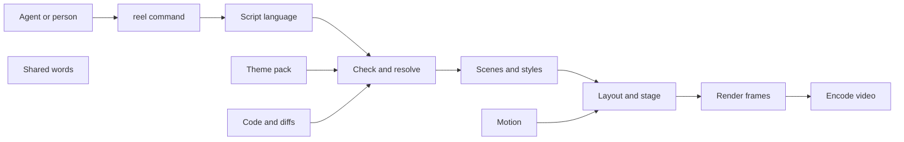

# reel

An agent writes a short text script. reel checks it, works out what is on
screen in each scene and how it moves, and renders an H.264 MP4. Everything,
including the encoder and fonts, is inside one binary. Choose a box with a +
to learn more.



These boxes are parts of one program, arranged as separate areas that each
own one job. Each area only depends on the areas to its left, so the drawing
code never needs to know how a script is written. [Shared words](domain-language.md)
defines the terms every page uses.

## What works today

- `reel check FILE` parses and resolves a script and reports problems with
  line numbers and a fix hint. `--json` prints the same report for agents.
- `reel check --explain SELECTOR FILE` shows where each property of the
  matching elements came from.
- `reel still FILE` draws each scene as a PNG, in its state after all of the
  scene's steps. `--scene NAME` draws one scene.
- `reel render FILE` renders the whole script to an MP4. `--crf` trades size
  for quality and `--preset` trades speed for size.
- `reel ref` prints the built-in kinds, steps and properties.
- `go run -tags resvg ./cmd/bench` renders a four-shot storyboard to measure
  drawing speed. It does not read scripts.

Arrays, charts, timelines, Mermaid and maths are not drawn yet; they appear
as labelled placeholders. Code and diffs are drawn; see
[Show code and diffs](show-code.md).
The [design spec](../spec.html) describes them.

## Try it

```sh
make build          # needs x264 to build, not to run
./bin/reel render examples/cache-refresh.reel
./bin/reel render examples/code-review.reel
./bin/reel check examples/cache-refresh.reel
./bin/reel check --explain '#p3' examples/cache-refresh.reel
./bin/reel still -o out examples/cache-refresh.reel
```

`go build ./cmd/reel` without x264 still works for `check` and `still`;
`render` then explains that the encoder is missing.
