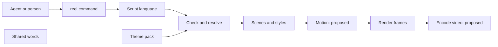

# reel

An agent writes a short text script. reel checks it, works out what is on
screen in each scene, and renders a video. Today reel can check scripts and
explain their styling. Drawing frames works in a benchmark; turning a script
into a video is still being built. Choose a box with a + to learn more.



These boxes are parts of one program, arranged as separate areas that each
own one job. Each area only depends on the areas to its left, so the drawing
code never needs to know how a script is written. [Shared words](domain-language.md)
defines the terms every page uses.

## What works today

- `reel check FILE` parses and resolves a script and reports problems with
  line numbers and a fix hint. `--json` prints the same report for agents.
- `reel check --explain SELECTOR FILE` shows where each property of the
  matching elements came from.
- `reel ref` prints the built-in kinds, steps and properties.
- `go run -tags resvg ./cmd/bench` renders a four-shot storyboard to measure
  drawing speed. It does not read scripts.

Motion, layout, the built-in video encoder and `reel render` are not built yet.
The [design spec](../spec.html) describes them.

## Try it

```sh
go build -o bin/reel ./cmd/reel
./bin/reel check examples/cache-refresh.reel
./bin/reel check --explain '#p3' examples/cache-refresh.reel
```
