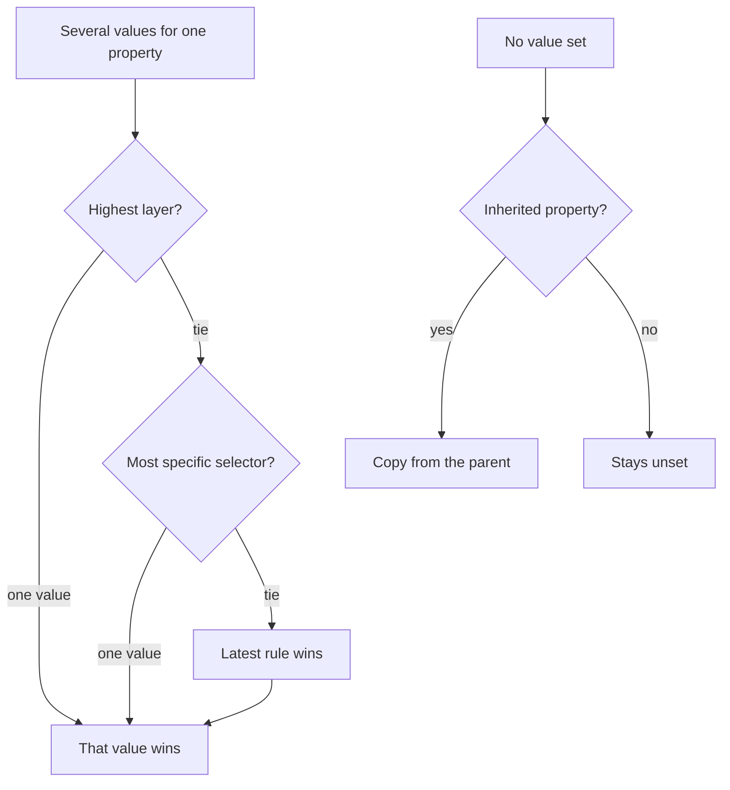

# Which style value wins

A theme can say processes fade in, the script can say `.hot` elements are
focused, and an element's own line can say something else. For each property
on each element, reel picks one winner with fixed rules, so the result never
depends on luck. `reel check --explain SELECTOR FILE` prints the winner and
where it came from.

## Layer first

From lowest to highest: theme defaults, theme rules, the script's `style`
block, then values written on the element's own line. A higher layer always
wins, whatever its selector. There is no `!important`.

## Then specificity

Within one layer, a more specific selector wins. Ids count most, then classes,
parts, attributes and positions such as `:first`, then kinds. `#api process`
beats `.hot`, which beats `process`. For a group like `#a, .b`, the most
specific member that matches is used. `:not(…)` counts as its argument.

## Then order

If layer and specificity tie, the rule written later wins.

## Inherited properties

`font`, `color`, `enter` and `exit` flow from a container to its children
when nothing sets them on the child. The hairline theme sets `enter` and
`exit` on every element, so in practice those two inherit only in themes that
leave them unset. `--explain` marks inherited values.
