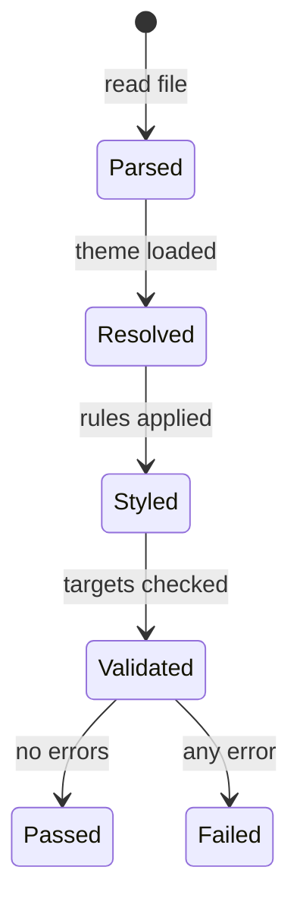

# Check a script

`reel check` reads a script and reports every problem it can find in one run,
each with a line, a column and a hint. It exits with 0 when there are no
errors, even if there are warnings, and 1 otherwise. Nothing is drawn.

## Reading the lines

The [script language](script-language.md) parser turns text into nested
lines. Mistakes here do not stop the check. The rest of the steps run on
whatever could be read, so later problems are still reported.

## Building the scenes

The theme named in the `video` block is loaded first. Its style rules become
the lowest cascade layer and its `define` blocks become components such as
`server` and `laptop`. Then the script's own style rules, components and
sequences are collected.

Each scene starts with what was on screen at the end of the previous scene.
A scene that begins with `clear` starts empty, or keeps only what matches
`clear keep=…`. Each line then becomes one of these:

- A step, such as `focus #api` or `say "…"`.
- A sequence call, which expands into its steps and connectors.
- A part address such as `#api/procs`, whose indented lines are added inside
  that part.
- An element. A component expands into its parts. Inside a component, `#name`
  names a part, `{param}` is replaced, `repeat` copies lines with `{i}`, and
  `slot` is where the caller's indented lines go.

Unknown kinds, properties, themes and parameters are reported with the
closest valid name.

## Styling every scene

Every element gets its final property values from the [cascade](cascade.md).
Rules are matched after the whole scene is built, so a rule can target parts
inside components.

## Final checks

Each scene is checked for ids used twice, including ids still on screen from
an earlier scene. Every step target and connector end must match something on
screen. Inside a component, connector ends refer to that component's own parts.
Values with a fixed vocabulary, such as `enter`, `exit`, `state` and
durations, are checked where they are written.

## When the check fails

Any error makes `reel check` exit with 1. Warnings, such as an unknown
property or a style rule that names no known kind, are printed but do not fail
the check. The same report is available as JSON with `--json`.

Repeated problems from elements carried into later scenes are reported once.

## Pacing warnings

A clean script is also checked against what research on narrated diagrams
says people can follow (cited in `skills/reel/references/explaining.md`).
These are warnings, never errors:

- a heading longer than 8 words, since viewers cannot read a sentence while
  listening to another;
- a scene that narrates more than about 45 words, since speech fades and
  the start of a long passage is lost;
- a line spoken slower than 130 or faster than 210 words a minute, once its
  real length is known from the voice;
- more than 12 rows of code on screen, since code is a cue for a reviewer,
  not the explanation.

## Scene lengths

When the script is clean, `reel check` prints each scene's length and start
time and the video's total, from the same plan `reel render` uses. `--json`
includes them as `seconds` and `start` per scene. `--timeline` lists every
step with its start, its length and its line, which is how to see whether a
highlight lands with the line that talks about it.
