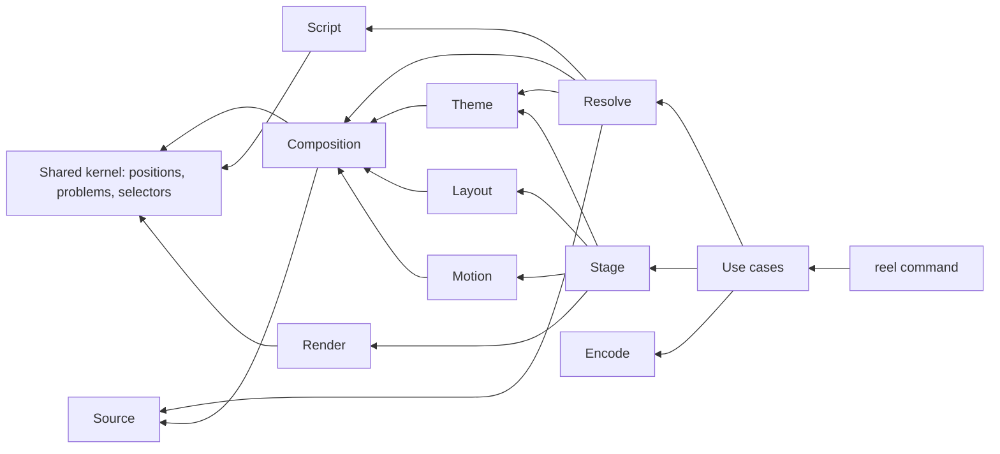

# Shared words and areas

reel is split into areas that each own one job and one set of words. A word
means the same thing in the code, the script, the CLI output and these pages.
Code in one area may use the areas it points to, never the reverse.

Composition is the core. It does not know script syntax, drawing libraries or
video formats. Resolve translates a script into composition terms, so the
script language can change without touching the core. Render only sees a
display list, so a different drawing library is a new adapter, not a rewrite.

## Areas

| Area | Package | Owns |
| --- | --- | --- |
| Script | `internal/script` | Reading `.reel` text into lines, nesting and tokens |
| Shared kernel | `internal/diag`, `internal/selector` | Positions, problem reports, the selector language |
| Composition | `internal/composition` | Video, scenes, elements, steps, style rules, the cascade |
| Theme | `internal/theme` | Theme packs: tokens, default rules, components |
| Source | `internal/source` | Diff parsing, numbered lines, line selections; `syntax` classes tokens |
| Resolve | `internal/resolve` | Turning script lines into composition, with checks |
| Layout | `internal/layout` | Sizes and positions: rows, columns, grids, layers, places |
| Motion | `internal/motion` | The plan: when things enter, change, move and leave |
| Stage | `internal/stage` | How each kind and state looks, painted into a display list |
| Render | `internal/render` | Display lists and the rasterizer port and adapters |
| Encode | `internal/encode` | The encoder port, frame conversion, the MP4 writer and the x264 adapter |
| Use cases | `internal/app` | Check, explain, still and render |
| Interface | `cmd/reel` | The command line |

Stage is the only area that knows both the composition model and the
display list. Use cases receive the rasterizer and encoder from the command
line, so they never import a drawing or video library directly.

## Words

| Word | Meaning |
| --- | --- |
| Video | One script's result: title, size, frame rate, theme, scenes |
| Scene | One shot. Holds what is on screen and the steps that happen |
| Element | One thing on screen: a primitive, a component instance, a part, a layout or a connector |
| Primitive | A built-in drawable kind such as box, circle or label |
| Component | A kind defined from other kinds with `define`, such as server |
| Part | A named element inside a component instance, addressed as `#api/unit1` |
| Connector | An element joining two others, written `a -> b` |
| Step | Something that happens during a scene, such as focus or leave |
| Sequence | A named, reusable list of steps |
| Selector | A pattern that picks elements, such as `#api process:not(.hot)` |
| Rule | A selector with property values, from a theme or a style block |
| Cascade | The fixed order that decides which value wins when rules disagree |
| Theme pack | Tokens, default rules and components that set the look |
| Design units | The coordinate space layout uses: the frame's short side is 720 units |
| Plan | The timeline of every scene: enters, state changes, camera, captions, exits |
| Moment | One scene at one time; what the stage paints |
| Appearance | One element at one moment: opacity, traced share, rise, state blend |
| End state | How a scene looks after all of its steps have run |
| Display list | The drawing operations for one frame, independent of any library |
| Rasterizer | A port that turns a display list into pixels |
| Diagnostic | A problem with a position, severity and fix hint |
| Hunk | One `@@` section of a diff |
| Focus | The lines of a code block shown at full strength |
| Mark | A step that moves the focus to other lines or cells |
| Pointer | A named index shown above an array cell |
| Rank | A Mermaid node's column (LR) or row (TD), by longest path from a start |
| Token | A named colour, size or timing a theme pack sets |
| Pack | A theme: tokens, style rules and components in one theme.reel |
| Orientation | Landscape or portrait, from the video size; style blocks can target one |
| Fit | Turning rows and scaling a scene so it fits the frame |
