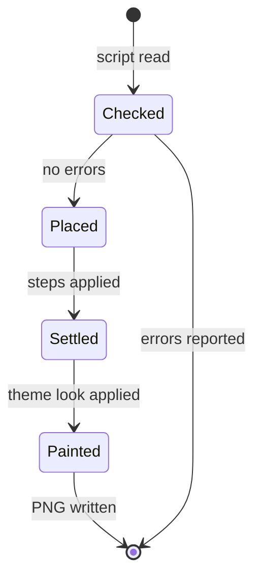

# Draw a still

`reel still FILE` draws every scene as a PNG, showing how it looks once all
of its steps have run. It is the quickest way for an agent or a person to see
a script before animation exists. `--scene NAME` draws one scene, and `-o`
picks the folder or file. `--at 42.5` draws the single frame at that many
seconds into the video instead, mid-animation, with narration lengths read
from the cache as `reel check` does.

## Only clean scripts are drawn

The script is [checked](check-a-script.md) first. Any error stops the command
and prints the same report as `reel check`. Warnings do not stop it.

## Placing elements

Layout works in design units, where the frame's short side is 720 units. A
1920×1080 and a 1080×1920 frame therefore use the same type and line sizes.
The scene's top-level elements form a centred column inside the stage area,
which leaves room at the bottom for the caption.

- `row` and `col` place children in a line with `gap`, `align` and `justify`.
- `grid cols=N` places children in equal cells.
- `layer` stacks children on top of each other. `place` uses `x` and `y`.
- A component is laid out as a centred column of its parts.
- Text is measured with the embedded fonts, so boxes fit their labels.
  Paragraphs wrap at 640 units. A card wraps its text at about 250 units,
  or at its `w=`, and grows taller to fit; `title=` adds a header above a
  rule.
- `w` and `h` override any measured size.

Connectors take no space. A row too wide for the frame is turned or scaled,
as [Fit the frame](fit-the-frame.md) describes.

## Running the steps

A still is the scene's [plan](play-a-scene.md) at the moment after its last
step, before anything leaves to make room for the next scene. States,
removals, the camera and the caption are exactly what the video shows at
that moment.

## Painting

The stage paints each element with the hairline look, reading colours and
sizes from the theme's tokens.

- States change line and text brightness. Focus adds a faint fill, select
  adds corner brackets, trace dashes the line and active adds a dot.
- Dim and focus pass down to a component's parts. A component with a state
  draws a frame around itself.
- Titles and captions show `==text==` brighter than the rest.
- Connectors are straight when their ends line up and right-angled when they
  do not. Labels sit above a horizontal segment.
- Code and diff blocks are drawn as panels; see [Show code and diffs](show-code.md).
- Arrays, charts, timelines, diagrams and maths are drawn as described in
  [Show arrays, charts, timelines, diagrams and maths](show-data.md).
