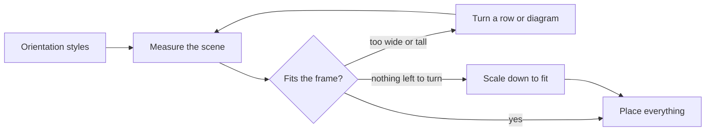

# Fit the frame

A script names one size, and changing `size 1920x1080` to `size 1080x1920`
is enough to get a phone cut. The engine fits each scene to the frame the
way a responsive page does. Style blocks for one orientation adjust whatever
the automatic fit does not get right.



## Orientation styles

`style portrait` and `style landscape` hold rules that apply only in that
orientation, like a CSS media query. A frame taller than it is wide is
portrait. Rules for the other orientation are still checked, so a typo shows
up whichever size you render.

```text
style portrait
  #stack  dir=col        # this row becomes a column on phones
  .aside  hidden=true    # leave the terminal out of the phone cut
```

`dir=row` or `dir=col` turns any row or column the other way; on a Mermaid
flowchart `dir=LR` or `dir=TD` does the same. `hidden=true` removes an element
from layout and drawing; connectors to it are not drawn either.

## Room for labels

Before measuring, the engine finds labelled connectors between neighbouring
elements in a row and widens the gap between them so the label fits.

## Turning rows and diagrams

While the scene is wider than the frame, the widest row is turned into a
column, and a left-to-right flowchart into a top-to-bottom one. While it is
taller than the frame, the tallest column becomes a row if its children
would then fit across. Rows and columns with their own `dir`, or with
`fit=false`, are left alone; a flowchart's `LR` or `TD` header is only a
preference.

## Scaling what is left

If the scene still does not fit, everything is scaled down evenly around the
centre of the stage. Captions are not scaled. The camera still zooms into a
target at full size.
