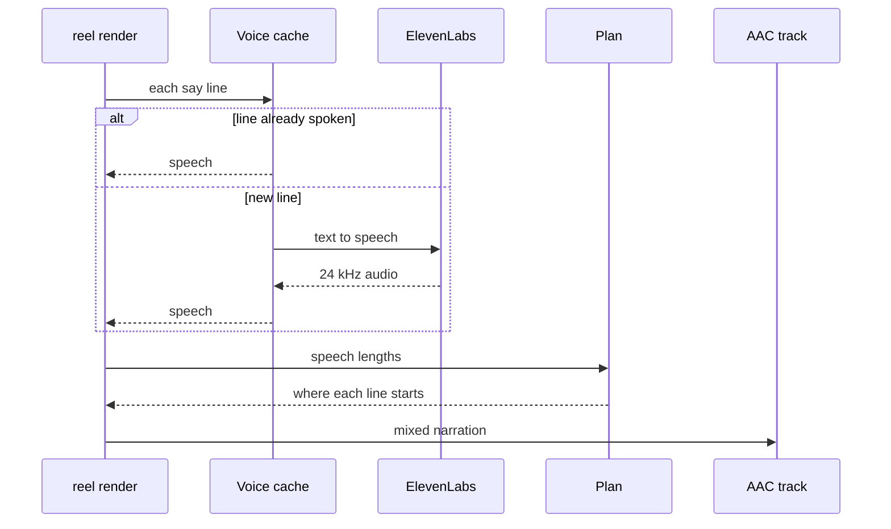

# Narrate a video

A script names a voice once. When `reel render` runs, every `say` line is
spoken by that voice, the scene lasts long enough for the speech, and the MP4
carries the narration as an AAC track next to the video. Captions still show.
`reel check` and `reel still` never call the voice service; they estimate
speech length from the words.



## Writing it

```text
video "PR 482 · one refresh per key"
  voice elevenlabs JBFqnCBsd6RMkjVDRZzb model=eleven_multilingual_v2

scene fix
  diff #d file=pr.diff focus=+26..+29
  say "singleflight lets ==one caller load==" speak="Single flight lets one caller load the key while every other caller waits."
```

`voice elevenlabs VOICE_ID` picks an ElevenLabs voice; `model=` is optional,
and `stability=`, `similarity=` and `style=` (0 to 1) and `speed=` (0.7 to
1.2) shape the delivery. Lower stability and some style sound more like
someone talking than reading. The free ElevenLabs plan can use only the
built-in voices through the API, not library voices. `say` speaks its
caption, without the `==` marks. `say speak="…"` with no caption shows and
speaks the same words. Giving both, `say "short heading" speak="…"`, shows
the short heading and speaks the longer sentence. `voice silent`
times a script as if it were narrated, with no sound and no service, which is
useful for tests.

## Local voice

`voice phonon` narrates on this machine, in the Harper voice unless the
line names another (`voice phonon Easton`). It uses Gradium's Phonon 31M
English model (Apache-2.0): no account, no key, no network after the first
use, and no cost per line. The runtime (ptts, MIT or Apache-2.0) is
compiled into reel by a small Rust wrapper in
`internal/voice/phonon/native`, which `make build` builds with cargo and
links statically, adding about 8 MB to the binary.

`make build` and the release binaries carry the pinned checkpoint (62 MB)
and the Harper voice inside the binary, which makes it about 93 MB; the
first narrated render copies them into the cache
(`~/Library/Caches/reel/phonon` on macOS), so narration works offline from
the start. Other voices, about 250 KB each, download from Hugging Face the
first time a script names them. `make build BUNDLE=0` leaves the model out
and downloads it on first use instead. The catalog has about 100 voices; an unknown name lists the
English ones. `model=/path/to/folder` uses a checkpoint folder of your own
instead, and `temperature=` (0 to 2) varies the delivery. The same line is
always spoken the same way, so cached and fresh renders match. Phonon
reports no word timings, so subtitles follow estimated ones. On an Apple
laptop CPU a three-minute walkthrough speaks in about ten seconds.

A build without Rust (`go build`) has no local voice and says so.

## The API key

The key is read from `ELEVENLABS_API_KEY`. If it is not set, reel looks for a
`.env` file with `ELEVENLABS_API_KEY=…` in the script's folder and its parents,
then the current folder and its parents. Scripts never contain the key. Keep
`.env` out of version control; this repository ignores it.

Without a key, `reel render` stops and says how to fix it. `reel render --mute`
renders headings only.

## Timing

The timing rules are part of [Play a scene](play-a-scene.md), and the track is
added at the end of [Render frames](render-pipeline.md).

Narration never overlaps: a `say` waits until the previous line has finished.
A `say` is a step like any other, lasting as long as its speech plus a short
breath, so the step after it waits until the line is spoken. To show
something while a line is spoken, start that step with `with`:

```reel
  say "Trimmed past ==1024== records" speak="Only the last 1024 records are kept."
  with mark #schema lines=+107..+108
```

To land a highlight on the word that names it, give the step `on=` with
the words, after the line:

```reel
  say "The ==grant log==" speak="The grant log lists every share and revoke."
  focus #log on="grant log"
  focus #revoke on="revoke"
```

The step starts 0.12 s before the first of those words is said, so the eye
arrives as the ear does. Word times come from the voice; with none, a
word's place in the line stands in. Steps with `on=` never hold back the
steps after them. `reel check` reports words the line does not say.

Speaking is a step like any other, so drawing can follow it. `show #x
on="the peer"` draws an element in, with its enter animation, as the words
are said; until then it is not on screen, and connectors to it wait for it.
A flowchart with `reveal=steps` starts empty: each `walk` brings in the
parts it visits, the link into a new part drawing first and the part
fading in where it lands, and parts never walked or shown stay hidden, also
when the diagram is carried into the next scene. Put `fit=false` on it to
keep its direction while it grows.

`play #seq to=2 on="asks"` reveals a sequence diagram up to its second row
(a timeline up to that time), and a later `play` carries on from there, so
a diagram is drawn piece by piece as it is told.

A `play` that starts while a line is spoken lasts the rest of that line, so
a sequence diagram's messages or a timeline's playhead unfold as the voice
talks them through. `for=` on the `play` overrides it.

`for=` on a `say` sets its length instead. A scene lasts at least until its
last line has been spoken, plus the usual hold.

Speech length comes from the audio. `reel check` and `reel still` read
lines spoken before from the cache without contacting the voice, so their
timings are exact for those lines; `reel check` says how many lines were
exact and estimates the rest from their word count.

## Heading and subtitles

A say line's caption is the scene's heading, at the top of the frame. It
shows from the scene's start and changes, with a short crossfade, when a
later line has a different caption; lines with the same caption keep it.

What is spoken shows at the bottom as subtitles, one short line at a time,
broken where the speaker pauses. They follow the voice: words not yet said
are dim, the word being said is bright, and said words settle. Subtitles
show only for lines with real speech, so a muted render or a script without
a voice shows the heading alone.

A scene's first line starts while the scene draws in, when nothing but
`clear` comes before it, so the voice carries from scene to scene without a
silent gap.

Word timing is generic. A voice adapter reports the timings its engine knows;
ElevenLabs reports a time for every character, which its adapter groups into
words. The core then matches those words to the caption's words, ignoring
case and punctuation, and gives any word the voice said differently (a number
read out in full) the time between its neighbours. If an engine reports no
timings (Phonon reports none), the core times words from the audio itself:
it finds where speech starts and ends and where the speaker pauses, matches
those pauses to the line's punctuation in order (a comma the speaker ran
through gets none), and spreads words by length within each phrase.
Against ElevenLabs' real timings this puts word starts about 90 ms out on
average, where spreading words evenly over the clip was 190 ms out.

## Caching

Spoken lines and their word timings are cached by voice, model and text in
the user cache folder (`~/Library/Caches/reel/voice` on macOS). Re-rendering a script only pays for
lines that changed, and an unchanged script renders identically and offline.

## The audio track

Lines are mixed onto one 24 kHz mono track at their start times and encoded
to AAC-LC at 96 kb/s by an encoder compiled into the binary. The MP4 stores
the track next to the video with its index first, like the video.

## Not built yet

Local voice models (Kokoro or Kitten through an ONNX runtime) and voices from
a model file path.
