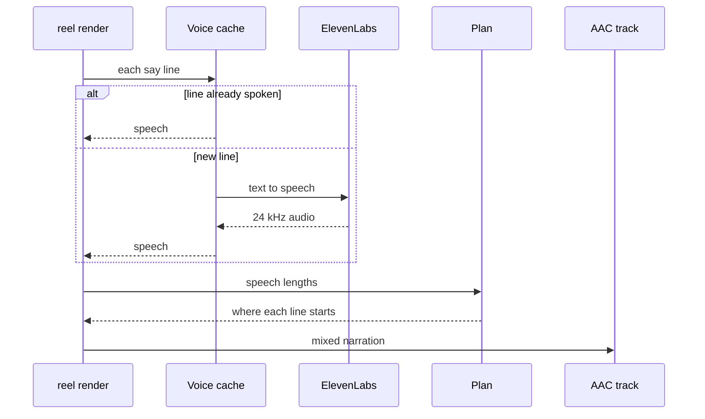

# Narrate a video

A script names a voice once. When `reel render` runs, every `say` line is
spoken by that voice, the scene lasts long enough for the speech, and the MP4
carries the narration as an AAC track next to the video. Captions still show.
`reel check` and `reel still` never call the voice service; they estimate
speech length from the words.



## Writing it

```text
video "PR 482 · one refresh per key"
  voice elevenlabs JBFqnCBsd6RMkjVDRZzb model=eleven_multilingual_v2

scene fix
  diff #d file=pr.diff focus=+26..+29
  say "singleflight lets ==one caller load==" speak="Single flight lets one caller load the key while every other caller waits."
```

`voice elevenlabs VOICE_ID` picks a voice from the ElevenLabs library; `model=`
is optional. `say` speaks its caption, without the `==` marks; `speak=` gives
different words to speak when the caption should stay short. `voice silent`
times a script as if it were narrated, with no sound and no service, which is
useful for tests.

## The API key

The key is read from `ELEVENLABS_API_KEY`. If it is not set, reel looks for a
`.env` file with `ELEVENLABS_API_KEY=…` in the script's folder and its parents,
then the current folder and its parents. Scripts never contain the key. Keep
`.env` out of version control; this repository ignores it.

Without a key, `reel render` stops and says how to fix it. `reel render --mute`
renders captions only.

## Timing

The timing rules are part of [Play a scene](play-a-scene.md), and the track is
added at the end of [Render frames](render-pipeline.md).

Narration never overlaps: a `say` waits until the previous line has finished.
A scene lasts at least until its last line has been spoken, plus the usual
hold. Speech length comes from the actual audio at render time, so a narrated
render can be a little longer or shorter than `reel check` estimated.

## Caching

Spoken lines are cached by voice, model and text in the user cache folder
(`~/Library/Caches/reel/voice` on macOS). Re-rendering a script only pays for
lines that changed, and an unchanged script renders identically and offline.

## The audio track

Lines are mixed onto one 24 kHz mono track at their start times and encoded
to AAC-LC at 96 kb/s by an encoder compiled into the binary. The MP4 stores
the track next to the video with its index first, like the video.

## Not built yet

Local voice models (Kokoro or Kitten through an ONNX runtime) and voices from
a model file path.
