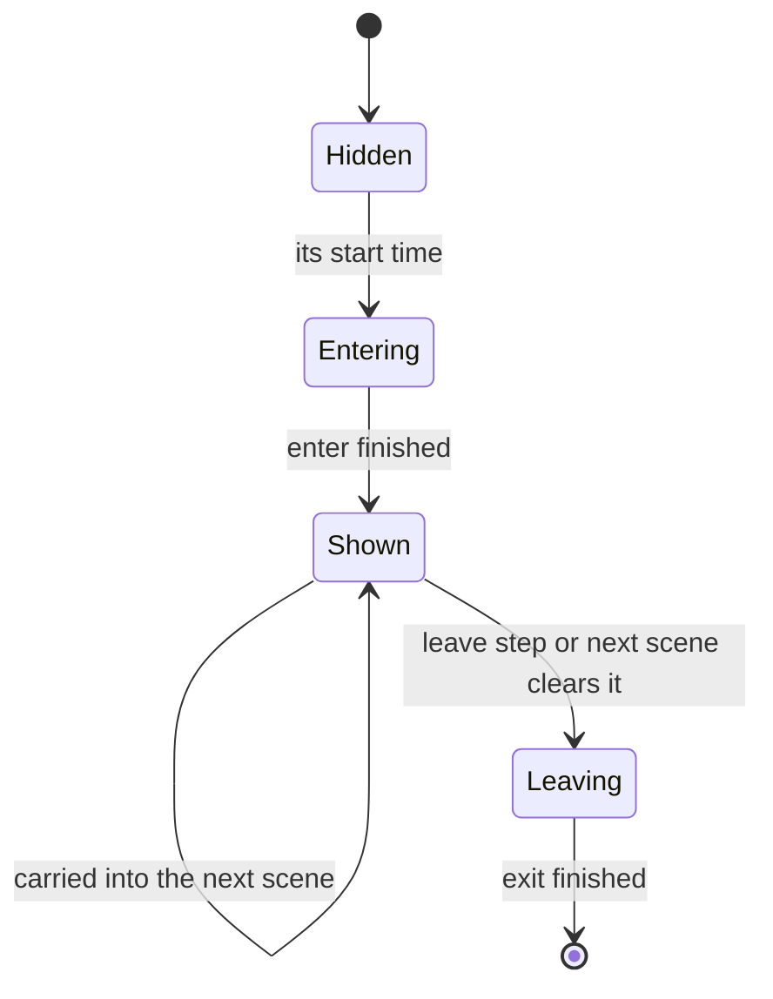

# Play a scene

The motion area turns a script into a plan: when each element enters and
leaves, when its state changes, where the camera points and which caption
shows. Any frame can then be drawn from the plan and a time alone, so frames
are drawn in parallel.

## Before an element enters

New elements are hidden until their start time. A scene opens with a short
lead, then its new top-level elements start one after another. Parts of a
component start a little after each other; `stagger=` on the component
changes that gap.

## Entering

The element's `enter` mode decides how it appears. `draw` traces outlines
first, then fades in fills and text. `fade` fades in, `rise` fades in while
moving up, and `none` appears at once. A component that fades in fades all
of its parts with it. A connector draws once both of its ends have entered.

## Changing state

Steps start once everything has entered. Each step waits for the one before
it unless it starts with `with`, which runs it alongside the previous step.
`at=2s` starts a step at a fixed time in the scene and `at=+0.5s` starts it
half a second after the previous step started. `for=` sets its length.

A state step such as `focus` blends lines, fills and text from the old state
to the new one. Dim and focus pass down to a component's parts. `send` moves
a dot along the connector that starts at its target or one of its parts;
`send #lb to=#s2` takes the connector that ends at `#s2`. `set #x "9"`
changes an element's text, fading the old text out and the new in; on a
component it changes the parts that showed the same text, and the layout
takes the new size. `type` reveals a
terminal or text block character by character; inline marks such as
`==this==` are skipped so emphasis is never cut in half. `camera zoom`
moves the view to frame its target and `camera reset` moves back.
`mark #d lines=…` moves the focus of a code or diff block to other lines.
For data blocks, `ptr` slides an array pointer, `swap` exchanges two cells,
`mark #a cells=…` brightens cells, `walk` lights a diagram's nodes in order
and `play` sweeps a timeline's playhead; see
[Show arrays, charts, timelines, diagrams and maths](show-data.md).

## Growing and shrinking

A `row`, `col` or `grid` with `flow=live`, and every `table`, gives room only to children on
screen. A child that a later `show` brings in takes no room until then;
when it is shown, its neighbours glide apart over half a second while it
fades in. A child that leaves fades out first, then its neighbours glide
together. Without `flow=live` a container keeps room for every child, so
nothing else moves. While a scene grows and shrinks its content keeps its
top left corner where the scene's fullest layout puts it, rather than
centring afresh, so an item added to a list moves only the items after it.
Connectors follow the elements they join. One step that
changes several things, such as a `set` on a component, moves everything
together.

## Requests, health checks and failures

`send #lb to=#s2 reply` sends a dot down the connector and, after a short
pause at the server, back again; `send … drop` turns the dot red where it
arrives and lets it fall. `ping #lb to=#s2` is a health check: a smaller
dot that turns green as it reaches a healthy element, or red if the
element is down. `fail #s2` puts an element in the down state: a red
tint and red text, and every connector touching it turns red and dashed;
`recover #s2` brings it back. Colours change smoothly over the step, and
a failed element keeps its place, so nothing else moves.

A connector a reply travels draws two hairline lanes, one each side of
its centre line: the request rides the upper lane and the reply comes
back on the lower one, so the two never share a line (`lanes=2` or
`lanes=1` on the connector decides for it). At the far end the packet
crosses smoothly to the reply lane. `send #client "req 1" reply="{good:200}"`
sends a card with that text instead of a dot; at the far end its text
cross-fades to the reply. `send #client to=#svc …` follows connectors
through whatever sits between, pausing at each element it passes, and
the reply comes back the same way; a send with `reply=` to the nearest
element is refused there (a breaker's 503, a limiter's 429). Cards stop
short of the boxes they join. `send … spend=#rl` takes a token from a
meter (the first meter in a component): the dot arcs from the meter onto
the card and the meter drops by one.

`set #s "Open" tone=bad` changes text and tone together, the colour
blending over the step; `set #b outline=bad` changes only an outline. On
a component, a text change goes to the parts showing its text and a tone
change to the parts toned like its first toned part. `play #s for=4s` on
a `status` light (or a component holding one) shows a small countdown
ring beside its label; a timer's or status ring starts full at every
play. `move #e first` (or `last`) moves a child to the front of its
container among the children on screen; the others glide, and the moving
one dips as it passes them.

## Travelling

Any element can travel, not just the send dot. `move #job to=#w1` takes
it from where it is to `#w1`'s place over the camera time and leaves it
there; `move #job to=#w2` continues from `#w1`, and `move #job` brings it
home. `send #client to=#api carry=#req` carries `#req` along the
connector in place of the dot, with `reply` bringing it back; an element
written with `travel=true` takes no room in the layout and is seen only
while something carries it. `show #c from=#n` and `leave #c to=#n` fly an
element out of, or into, another as it appears or goes, growing or
shrinking to the size of the place it is at.

## Git histories

A `git` block draws a history from commands, one per line: `commit`,
`branch` (or `switch -c`), `checkout`, `merge` (`ff` to fast-forward) and
`rebase`. Each branch has its own lane and colour, commits sit in
columns after their parents, and branch labels sit over their heads, side
by side when two share a commit. `play #g` runs the commands one at a
time: a commit's line draws in and its dot pops in, a branch label
slides to its new head, a merge commit is ringed in the merged branch's
colour, a rebase leaves dashed copies of the old commits that fade while
the new ones appear on top of the other branch, and a fast-forward
brings commits onto the branch's lane, changing colour as they move. The
command being run shows under the graph.

## Isolating one element

`isolate #n30 aside=#why` lifts one element out of the scene into a
spotlight for a closer look. Over about a second it grows and moves to
the left third of the frame (`layout=center` moves it to the top, `right`
to the right third), the rest of the scene recedes slightly and dims
(`backdrop=hide` fades it out), and a dashed outline marks where it came
from. The `aside` named by the step, a column written anywhere in the
scene, then comes in where the element left room; it takes no room in
the scene and stays hidden until an isolate step names it. Steps that
follow can `show` its parts, including `show #c20 from=#n20`, which flies
a copy out of the scene into the aside.

`return #n30` ends it: the aside's parts leave in reverse order with
their own `exit=` (those flown in fly back), parts with `keep=true`
stay, `order=together` or `order=cut` change the timing, and then the
element glides back into its outline as the scene comes forward again.
A tree node is lifted on its own; its children stay in the tree.

## Leaving

`leave` plays the element's `exit` mode in reverse of its enter, and
`leave #x exit=fade` overrides it once. When the next scene starts with
`clear`, everything it does not keep leaves at the end of this scene, which
makes this scene slightly longer.

## Across scenes

Elements that stay on screen into the next scene do not enter again. They
keep the state their last step gave them, and an array keeps its pointers
and marked cells. The camera keeps its target until a `camera` step moves
it.

A scene without `clear` keeps everything; `clear keep="#log"` keeps just
the matching elements, lifted out of whatever held them, while the rest
leaves at the end of the scene before. A kept element glides, over 0.7 s,
from where it was on screen to its place in the new layout, growing or
shrinking as the new scene needs, while new elements draw in around it.
That is how one picture can carry a story across scenes: keep the diagram
and add to it, rather than clearing and drawing a new one.

## How long a scene lasts

A scene lasts until its last step ends plus a one-second hold, or until its
last caption has had time to be read, whichever is later. `hold 2s` adds to
the hold. `scene name 6s` fixes the length exactly; anything past it is cut.
Reading time assumes about 2.8 words per second.

With a voice, narration sets the pace instead of reading time: each line
waits for the previous one to finish, and the scene lasts until its last line
has been spoken. See [Narrate a video](narrate.md).

Durations come from the theme: draw 0.6 s, fade 0.35 s, rise 0.45 s, state
changes 0.3 s, camera moves 0.7 s and packets 0.8 s. All motion uses the same
ease-in-out curve.
