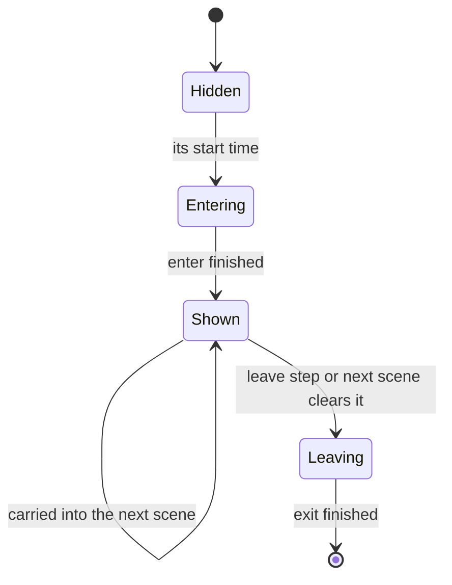

# Play a scene

The motion area turns a script into a plan: when each element enters and
leaves, when its state changes, where the camera points and which caption
shows. Any frame can then be drawn from the plan and a time alone, so frames
are drawn in parallel.

## Before an element enters

New elements are hidden until their start time. A scene opens with a short
lead, then its new top-level elements start one after another. Parts of a
component start a little after each other; `stagger=` on the component
changes that gap.

## Entering

The element's `enter` mode decides how it appears. `draw` traces outlines
first, then fades in fills and text. `fade` fades in, `rise` fades in while
moving up, and `none` appears at once. A component that fades in fades all
of its parts with it. A connector draws once both of its ends have entered.

## Changing state

Steps start once everything has entered. Each step waits for the one before
it unless it starts with `with`, which runs it alongside the previous step.
`at=2s` starts a step at a fixed time in the scene and `at=+0.5s` starts it
half a second after the previous step started. `for=` sets its length.

A state step such as `focus` blends lines, fills and text from the old state
to the new one. Dim and focus pass down to a component's parts. `send` moves
a dot along the connector that starts at its target. `type` reveals a
terminal or text block character by character; inline marks such as
`==this==` are skipped so emphasis is never cut in half. `camera zoom`
moves the view to frame its target and `camera reset` moves back.

## Leaving

`leave` plays the element's `exit` mode in reverse of its enter, and
`leave #x exit=fade` overrides it once. When the next scene starts with
`clear`, everything it does not keep leaves at the end of this scene, which
makes this scene slightly longer.

## Across scenes

Elements that stay on screen into the next scene do not enter again. They
keep the state their last step gave them, and the camera keeps its target
until a `camera` step moves it.

## How long a scene lasts

A scene lasts until its last step ends plus a one-second hold, or until its
last caption has had time to be read, whichever is later. `hold 2s` adds to
the hold. `scene name 6s` fixes the length exactly; anything past it is cut.
Reading time assumes about 2.8 words per second.

Durations come from the theme: draw 0.6 s, fade 0.35 s, rise 0.45 s, state
changes 0.3 s, camera moves 0.7 s and packets 0.8 s. All motion uses the same
ease-in-out curve.
