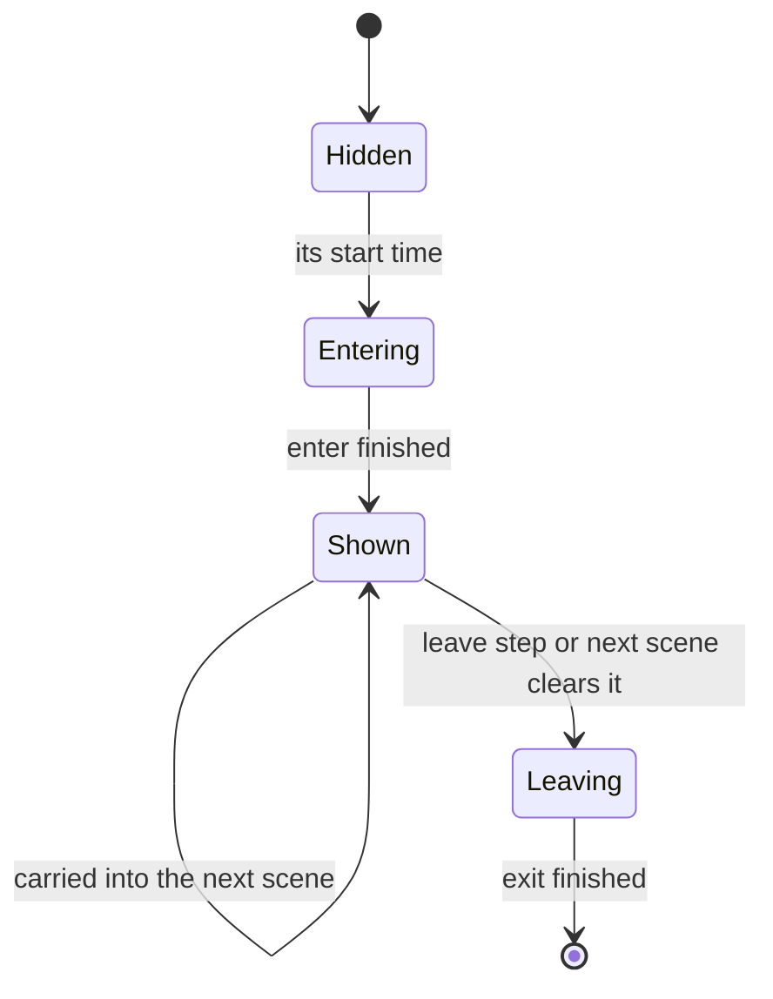

# Play a scene

The motion area turns a script into a plan: when each element enters and
leaves, when its state changes, where the camera points and which caption
shows. Any frame can then be drawn from the plan and a time alone, so frames
are drawn in parallel.

## Before an element enters

New elements are hidden until their start time. A scene opens with a short
lead, then its new top-level elements start one after another. Parts of a
component start a little after each other; `stagger=` on the component
changes that gap.

## Entering

The element's `enter` mode decides how it appears. `draw` traces outlines
first, then fades in fills and text. `fade` fades in, `rise` fades in while
moving up, and `none` appears at once. A component that fades in fades all
of its parts with it. A connector draws once both of its ends have entered.

## Changing state

Steps start once everything has entered. Each step waits for the one before
it unless it starts with `with`, which runs it alongside the previous step.
`at=2s` starts a step at a fixed time in the scene and `at=+0.5s` starts it
half a second after the previous step started. `for=` sets its length.

A state step such as `focus` blends lines, fills and text from the old state
to the new one. Dim and focus pass down to a component's parts. `send` moves
a dot along the connector that starts at its target or one of its parts;
`send #lb to=#s2` takes the connector that ends at `#s2`. `set #x "9"`
changes an element's text, fading the old text out and the new in; on a
component it changes the parts that showed the same text, and the layout
takes the new size. `type` reveals a
terminal or text block character by character; inline marks such as
`==this==` are skipped so emphasis is never cut in half. `camera zoom`
moves the view to frame its target and `camera reset` moves back.
`mark #d lines=…` moves the focus of a code or diff block to other lines.
For data blocks, `ptr` slides an array pointer, `swap` exchanges two cells,
`mark #a cells=…` brightens cells, `walk` lights a diagram's nodes in order
and `play` sweeps a timeline's playhead; see
[Show arrays, charts, timelines, diagrams and maths](show-data.md).

## Growing and shrinking

A `row`, `col` or `grid` with `flow=live`, and every `table`, gives room only to children on
screen. A child that a later `show` brings in takes no room until then;
when it is shown, its neighbours glide apart over half a second while it
fades in. A child that leaves fades out first, then its neighbours glide
together. Without `flow=live` a container keeps room for every child, so
nothing else moves. While a scene grows and shrinks its content keeps its
top left corner where the scene's fullest layout puts it, rather than
centring afresh, so an item added to a list moves only the items after it.
Connectors follow the elements they join. One step that
changes several things, such as a `set` on a component, moves everything
together.

## Leaving

`leave` plays the element's `exit` mode in reverse of its enter, and
`leave #x exit=fade` overrides it once. When the next scene starts with
`clear`, everything it does not keep leaves at the end of this scene, which
makes this scene slightly longer.

## Across scenes

Elements that stay on screen into the next scene do not enter again. They
keep the state their last step gave them, and an array keeps its pointers
and marked cells. The camera keeps its target until a `camera` step moves
it.

A scene without `clear` keeps everything; `clear keep="#log"` keeps just
the matching elements, lifted out of whatever held them, while the rest
leaves at the end of the scene before. A kept element glides, over 0.7 s,
from where it was on screen to its place in the new layout, growing or
shrinking as the new scene needs, while new elements draw in around it.
That is how one picture can carry a story across scenes: keep the diagram
and add to it, rather than clearing and drawing a new one.

## How long a scene lasts

A scene lasts until its last step ends plus a one-second hold, or until its
last caption has had time to be read, whichever is later. `hold 2s` adds to
the hold. `scene name 6s` fixes the length exactly; anything past it is cut.
Reading time assumes about 2.8 words per second.

With a voice, narration sets the pace instead of reading time: each line
waits for the previous one to finish, and the scene lasts until its last line
has been spoken. See [Narrate a video](narrate.md).

Durations come from the theme: draw 0.6 s, fade 0.35 s, rise 0.45 s, state
changes 0.3 s, camera moves 0.7 s and packets 0.8 s. All motion uses the same
ease-in-out curve.
