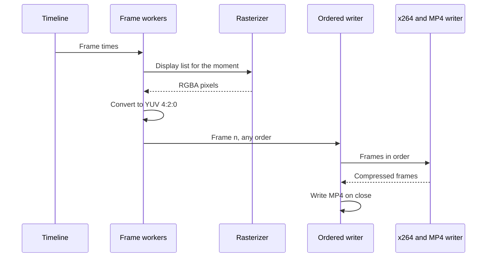

# Render frames

Each frame is described as a display list: an ordered set of shapes and text
with colours and transforms. A rasterizer turns it into pixels and an encoder
turns the pixels into video. Frames do not depend on each other, so they are
drawn in parallel and written in order.

`reel render` asks the [plan](play-a-scene.md) which scene is playing at each
frame time, paints that moment, rasterizes it and converts it to YUV on all
cores. An ordered writer hands frames to x264 one at a time, and the MP4 is
written with its index first so it can start playing before it has fully
downloaded. Frames held in memory are bounded to a few per core.

## Narration

When the script has a voice, the lines are spoken before any frame is drawn,
because their lengths set the timing. After the last frame, the narration is
mixed, encoded to AAC and added as a second track. See
[Narrate a video](narrate.md).

## The output file

H.264 High profile, 4:2:0, BT.709 colour, constant-quality mode (`--crf 18`
by default) with x264's `veryfast` preset and its animation tuning. There are
no B-frames, so every frame is stored in display order. A keyframe appears at
least every four seconds. The example script renders 17.4 seconds of 1080p
in about 1.5 seconds on an Apple M5.

`make build` links x264 statically. The resulting binary is about 10 MB and
needs only the operating system's own libraries. A build without cgo still
checks scripts and draws stills.

## Benchmark results

Four shots, 12 seconds at 1920×1080 and 30 fps, on an Apple M5 with 10 cores.

| Rasterizer | One core | Ten cores |
| --- | --- | --- |
| `canvas`, pure Go | 2.4 ms per frame | about 1,900 frames per second |
| `resvg`, Rust via cgo | 4.7 to 7.1 ms per frame | about 200 to 250 frames per second |

Both produced the same frames. The pure-Go rasterizer is the one reel uses.
With it, encoding takes most of the time, so the encoder matters more than
drawing speed. The benchmark itself still pipes to ffmpeg to compare encoders. Run `go run -tags resvg ./cmd/bench`; the resvg adapter needs
its Rust library built from `resvgshim`.

## Known gaps

Fonts are embedded in the binary. The bundled Latin font subset has no block characters, so a terminal cursor
must be drawn as a shape. Maths rendering through the built-in TeX engine
drops some glyphs and lacks LaTeX-only commands such as `\mathrm`.
