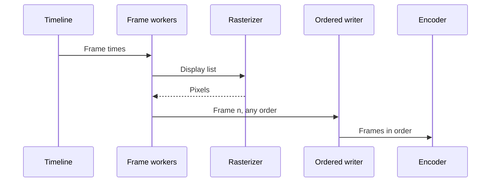

# Render frames

Each frame is described as a display list: an ordered set of shapes and text
with colours and transforms. A rasterizer turns it into pixels and an encoder
turns the pixels into video. Frames do not depend on each other, so they are
drawn in parallel and written in order.

Status: rasterizing is implemented and benchmarked. [Drawing a still](draw-a-still.md)
builds display lists from scripts; the benchmark in `cmd/bench` uses a
hand-built storyboard. Encoding in the benchmark goes through ffmpeg only to
measure it; the shipped binary will link x264 instead.

## Benchmark results

Four shots, 12 seconds at 1920×1080 and 30 fps, on an Apple M5 with 10 cores.

| Rasterizer | One core | Ten cores |
| --- | --- | --- |
| `canvas`, pure Go | 2.4 ms per frame | about 1,900 frames per second |
| `resvg`, Rust via cgo | 4.7 to 7.1 ms per frame | about 200 to 250 frames per second |

Both produced the same frames. The pure-Go rasterizer is the one reel uses.
With it, encoding takes most of the time, so the encoder matters more than
drawing speed. Run `go run -tags resvg ./cmd/bench`; the resvg adapter needs
its Rust library built from `resvgshim`.

## Known gaps

Fonts are embedded in the binary. The bundled Latin font subset has no block characters, so a terminal cursor
must be drawn as a shape. Maths rendering through the built-in TeX engine
drops some glyphs and lacks LaTeX-only commands such as `\mathrm`.
