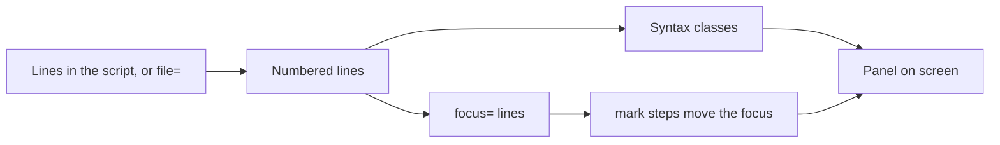

# Show code and diffs

A code review video mostly shows code. A `code` block shows lines of a file;
a `diff` block shows one hunk of a change, with removed lines tinted red and
added lines tinted green. Both colour the syntax and can dim every line except
the ones being discussed.



## Writing a code block

```text
code go focus=3..4
  func handler(w http.ResponseWriter, r *http.Request) {
      key := r.URL.Query().Get("key")
      cache.Refresh(key)
  }

code file=internal/cache/cache.go lines=24..32 focus=26
```

Indented lines are shown as written. `file=` reads a file instead; paths are
relative to the script. `lines=` limits a file to a range and keeps the
file's own line numbers. The language comes from the first word, `lang=`, or
the file name.

## Writing a diff block

```text
diff #d file=pr.diff path=cache.go hunk=1 focus=+26..+29
```

A diff is `git diff` output, pasted indented under the line or read with
`file=`. `path=` picks one file from a multi-file diff, and `hunk=` picks one
`@@` section, counting from 1. The header shows the file path and how many
lines were added and removed.

## Choosing lines

`focus=` and `mark lines=` take line numbers, ranges and lists:
`12`, `12..14`, `3,7..9`. In a diff, `+26..+29` means new line numbers and
`-26..-28` means old ones, so removed and added lines can be picked apart.
A number without a sign matches new numbers, or old numbers on removed lines.

Lines outside the focus are dimmed and focused lines get a bright bar at the
left edge. Without a focus every line is shown at full strength.

## Folding long blocks

A block longer than 16 lines that has a focus, or lines named by `mark` in the
scene, is folded down to those lines and `context=` lines either side (3 by
default). Each folded run shows as a dashed "N lines" row, so a large hunk
stays at a readable size instead of being scaled down. The header's +/−
counts still describe the whole hunk. `reel check` warns when a focus names
lines the block does not show.

## Animating

`mark #d lines=-26..-28` moves the focus during a scene, blending from the
previous selection. `type #d` types the code out character by character.
Steps are explained in [Play a scene](play-a-scene.md).

## Checks

`reel check` reports a missing file, text that is not a diff, a hunk or path
that does not exist, a bad line range, and a focus that matches no shown line.
An unknown language is a warning; the code is shown without colours.

## Colours

The hairline theme uses soft, low-contrast syntax colours so code reads well
on the dark ground: keywords violet, types cyan, functions amber, strings
green, numbers orange, comments grey. Each comes from a theme token such as
`syntax-keyword`, as do the diff tints `diff-add` and `diff-del`.
