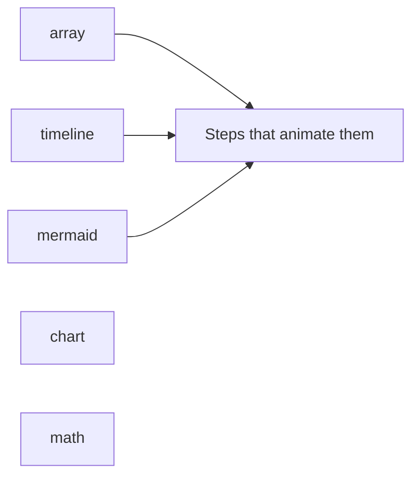

# Show arrays, charts, timelines, diagrams, maths and plots

These blocks cover what code review videos explain besides code: how an
algorithm moves through data, what changed in the numbers, what happens when,
how requests flow, and the cost of an approach.



## Arrays

```text
array #a 1 3 4 6 8 11 15 19 ptr="lo=0 hi=7"
ptr #a hi=5
swap #a 0 3
mark #a cells=1,5
```

Values are the words after the id. `ptr=` names pointers and their starting
cells, counting from 0. `ptr #a hi=5` slides a pointer, `swap #a 0 3` slides
two cells past each other, and `mark #a cells=…` brightens some cells and
dims the rest. Indexes are shown under the cells.

## Charts

```text
chart #c bar
  burst, before, after
  1, 4, 1
  2, 7, 1
```

The first line names the columns: the row label, then one series per column.
`chart bar` groups bars per row and `chart line` draws one line per series.
The axis rounds up to a tidy number close above the largest value the
chart shows in the scene, counting values that `set` steps bring, so it
never rescales while the chart moves.

The look follows one rule: one accent colour at a time, everything else
grey. A single series of bars is flat grey with its value above (or beside)
each bar; `focus=ROW` draws one row in the accent at rest. With several
series the last one is the bright grey. In a line chart the last series is
the accent and the others grey. Numbers use steady-width digits, so a
counting label never shifts.

As the chart enters, its frame draws in, then bars grow one after another
and lines trace left to right with a dot at their tip. Steps wait for that.

```text
chart #lat bar horizontal "p95 latency" unit=ms focus=/search
  endpoint, p95
  /checkout, 820
  /search, 610
set #lat /checkout=240
sort #lat
mark #lat row=/search
```

- `horizontal` runs bars left to right, labels on the left, values after
  the bars. `unit=` follows each value; quoted text is a caption on the right.
- `set #c ROW=240` eases that row's bar to the new value over 1.2 s while
  its label counts; the row takes the accent and the rest go grey. One value
  sets the last series, `ROW=1,2` every series. Row labels are the keys, so
  a label with spaces cannot be set this way.
- `sort #c` slides bars into order by their last series, largest first
  (`sort #c asc` smallest first). Accented bars draw on top as they pass.
- `mark #c row=ROW` moves the accent to another row.

```text
chart #rps line threshold="900 Capacity 900 rps" cross="Over capacity at {x} min"
  min, Region B, Region A
  0, 380, 260
  ...
```

`threshold=` takes a value and a label and draws a dashed line across. Where
each line first crosses it, a small ring grows once the line's tip gets
there, labelled by `cross=`; `{x}` becomes the place on the x axis
(interpolated when row labels are numbers).

## Timelines

```text
timeline #tl unit=ms
  request A | 4-66 wait | *68-82 200
  db load   | *8-62 one load for both
play #tl for=2.5s
```

Each line is a lane: a label, then spans as `from-to label`. A `*` marks a
span as important, drawn bright; others are dashed. `play` sweeps a playhead
from 0 to the last span's end, showing the time above it; the span outlines
draw in first and each span fills in as the playhead passes. The playhead
fades once it reaches the end. Without `play`, spans draw in filled.

```text
mark #tl span=orders note="Slowest call: orders, 130 ms of 236 ms"
```

`mark … span=NAME` singles out the spans with that label (or the spans of
the lane with that label): everything else dims, the span turns amber with
its length beside it, and a readout line appears under the axis: `note=`, or
the span's length against the whole. The timeline keeps room for the
readout from the start, so nothing moves when it appears.

## Tables in motion

A `set` on a table cell cross-fades the old text into the new in place:
every column is as wide as the widest text its cells take during the scene,
so nothing reflows. A row brought in by `show` slides down into place with a
soft highlight that fades after a moment while the rows below glide down.

## Diagrams

```text
mermaid #flow
  flowchart LR
    C[Client] --> G[Gateway]
    G --> H{Cache hit?}
    H -- yes --> R[Respond]
    H -- no --> D[(Database)]
walk #flow C G H D
```

A Mermaid flowchart (`LR` or `TD`) becomes ordinary reel elements: `[ ]`
boxes, `{ }` decisions, `(( ))` circles, `[( )]` stores and `( )` rounded
boxes. Links can be `-->`, `---`, `-.->`, `==>`, `-- text -->` or
`-->|text|`. Nodes are placed in ranks by their longest path from a start
node. A link that skips ranks goes over the boxes between its ends.

Because nodes are parts, `#flow/H` targets one node with any step, and
`walk #flow C G H D` lights each node and the link into it in order.
Subgraphs are not supported yet.

Sequence diagrams are drawn too:

```text
mermaid #seq
  sequenceDiagram
    participant C as Client
    C->>A: GET /items
    alt cache miss
      A->>D: SELECT items
      D-->>A: rows
    else cache hit
      Note over A: served from memory
    end
    A-->>C: 200 OK
play #seq for=3s
```

Participants get boxes and dashed lifelines. `->>` is a call, `-->>` a dashed
reply, `-x` a lost message, and a message to yourself loops back. `Note over`,
`left of` and `right of` add notes; `alt`, `else`, `opt`, `loop`, `par` and
`critical` draw labelled frames. `autonumber` numbers the messages. `play`
reveals the rows one after another; without it everything shows once the
diagram has entered.

## Maths

```text
math "T(n) = 2T(n/2) + O(n) \Rightarrow O(n \log n)"
```

Formulas are typeset by a TeX engine built into the binary and drawn as
outlines, so they take theme colours and fade like text. Backslashes on a
`math` line are left for TeX. Plain TeX is supported, plus `\mathrm`, `\text`,
`\mathbf`, `\mathit`, `\log`, `\ln`, `\max` and `\min`.

## Plots

```text
plot #p x=0..4pi y=-1..1 a=0
  y = sin(x) + a*sin(3x)/3
  curve x=sin(3t) y=sin(2t) t=0..2pi
  polar r = 1 + cos(theta) theta=0..2pi
  zeta(1/2 + i*t) t=0..30 marks=zeros
  point (1, 0.8) "peak"
play #p
set #p a=1 for=2.5s
```

A `plot` draws curves from expressions on hairline axes. Its line takes
the ranges the axes show (`x=`, `y=`; ends may use `pi`, `e` and
fractions, and an axis whose range names `pi` is labelled in multiples
of π), `square=true` for one unit as long on both axes, and parameters:
any other `name=value` (`a=0`) that curves can read and `set` can change.
A parameter cannot share its name with a property (`w`, `h`, `r` …), a
curve parameter (`x`, `t`, `theta`) or a function. Each indented line is
a curve or a point:

- `y = EXPR` is a function of x over the plot's x range (`x=a..b` after
  it limits it).
- `curve x=EXPR y=EXPR t=a..b` is parametric; write each expression
  without spaces or in quotes.
- `polar r = EXPR theta=a..b` (0..2π by default).
- Any other expression is a complex function of the parameter whose
  range follows it (`t=0..30`), drawn as (Re, Im).
- `point (x, y) "label"` is a dot with a label.

Expressions are parsed by a small Pratt parser and evaluated in complex
numbers: `+ - * / ^` (`**` too), unary minus, implicit products (`2x`,
`3t`, `2pi`, `(x+1)(x-1)`), the functions `sin cos tan asin acos atan exp
log ln sqrt abs floor min max re im arg conj gamma zeta` and the
constants `pi e i`. A real curve whose value turns complex (`sqrt(x)` left
of 0) is undefined there. `zeta` uses Euler–Maclaurin summation (N = 20,
Bernoulli terms to B14; accurate to about 1e-9 for |Im s| ≤ 40) and the
functional equation left of Re s = 0; `gamma` uses Lanczos.

Curves are sampled adaptively in screen space: segments longer than 6 px
or bending more than a third of a pixel from their chord are split, up
to ten times; a segment that never settles (an asymptote like tan's or
1/x's) or reaches an undefined point breaks the curve instead of drawing
a vertical line. Curves are clipped to the axes' box.

Look: hairline axes in the line colour through the origin (along the
nearer edge when the origin is out of view), spanning the whole box;
tick numbers in muted 11 px mono; the equations in mono at the top left;
the first curve 2 px in the accent with round caps (others grey); amber
for marks and notes.

Steps:

- `play #p` traces every curve from the start of its parameter to the
  end, with a dot (accent, ringed in the ground colour) at the tip that
  fades once the trace is done. The whole trace takes 4 s (`for=` sets
  it); during a spoken line it takes the rest of the line. `play #p
  to=t=14.13` (or `to=x=2`, naming the parameter of the first curve that
  has it) traces up to that value and stops, the dot waiting at the tip;
  the next `play #p` carries on, each taking its share of the 4 s.
  Without a play step a plot traces itself in as it enters.
- `set #p a=1 for=2.5s` eases a parameter (1.6 s by default); the curves
  morph and a readout `a = 0.62` with steady digits shows at the top
  right.
- `marks=zeros` on a curve rings each place the trace passes through the
  origin (for `y =`, each crossing of the x axis) in amber, with a pulse
  as the tip arrives and a label `zero at t = 14.13` for the latest one.
  Zeros are found at the parameters' starting values.
- `note #p (0,0) "first zero"` (or `at=(0,0)`) pins an amber ring and
  label to a place; the label sits on a backing in the ground colour, on
  the first side of the point that keeps it inside the box and clear of
  the tick numbers.
- `zoom #p x=-.35..0.55 y=-.45..0.45` rescales the axes so that region
  fills the box; `zoom #p` goes back. It is not a camera zoom: lines and
  text keep their size. The view is a centre and a scale: the scale
  moves on a log scale and the centre by w = (1 − k0/k)/(1 − k0/kZ), so
  the zoom closes in on one fixed point and the target's centre travels
  in a straight line to the middle, eased with smootherstep over 1.8 s.
  A zoom that starts while another runs carries on from where it was.
  Ticks come from candidate steps (… 2, 1, 0.5, 0.2, 0.1 …), each with
  alpha clamp((step·k − 34)/36, 0, 1); a tick takes the largest alpha of
  the steps it is a multiple of, so finer ticks fade in as room opens.
  Labels follow the steps that nest (1, 0.5, 0.1 …) and need more room;
  near the box's ends they fade out rather than pop.
- `isolate #p aside=#why` moves the plot's own box into the spotlight and
  lets it take the room there; the view keeps its centre and scale model,
  so the axes gain or lose range smoothly instead of the drawing being
  scaled. `return #p` glides it back.

A plot carried into the next scene keeps its trace, parameters, zooms
and notes.

## Known gaps

- The maths engine adds about 7 MB to the binary.
- Plot labels draw π, θ and ζ through the TeX engine (the bundled fonts
  are Latin only), so those letters are in its italic face.
- Zero marks are found once, at the parameters' starting values; a `set`
  that moves the zeros does not move the marks.

## Git histories

`git` blocks are described in [Play a scene](play-a-scene.md#git-histories).
