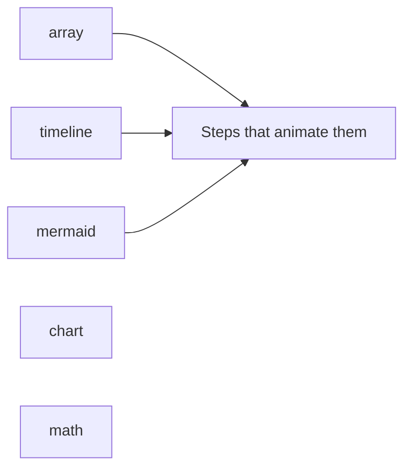

# Show arrays, charts, timelines, diagrams and maths

These blocks cover what code review videos explain besides code: how an
algorithm moves through data, what changed in the numbers, what happens when,
how requests flow, and the cost of an approach.



## Arrays

```text
array #a 1 3 4 6 8 11 15 19 ptr="lo=0 hi=7"
ptr #a hi=5
swap #a 0 3
mark #a cells=1,5
```

Values are the words after the id. `ptr=` names pointers and their starting
cells, counting from 0. `ptr #a hi=5` slides a pointer, `swap #a 0 3` slides
two cells past each other, and `mark #a cells=…` brightens some cells and
dims the rest. Indexes are shown under the cells.

## Charts

```text
chart #c bar
  burst, before, after
  1, 4, 1
  2, 7, 1
```

The first line names the columns: the row label, then one series per column.
`chart bar` groups bars per row and `chart line` draws one line per series.
The axis rounds up to a tidy number close above the largest value the
chart shows in the scene, counting values that `set` steps bring, so it
never rescales while the chart moves.

The look follows one rule: one accent colour at a time, everything else
grey. A single series of bars is flat grey with its value above (or beside)
each bar; `focus=ROW` draws one row in the accent at rest. With several
series the last one is the bright grey. In a line chart the last series is
the accent and the others grey. Numbers use steady-width digits, so a
counting label never shifts.

As the chart enters, its frame draws in, then bars grow one after another
and lines trace left to right with a dot at their tip. Steps wait for that.

```text
chart #lat bar horizontal "p95 latency" unit=ms focus=/search
  endpoint, p95
  /checkout, 820
  /search, 610
set #lat /checkout=240
sort #lat
mark #lat row=/search
```

- `horizontal` runs bars left to right, labels on the left, values after
  the bars. `unit=` follows each value; quoted text is a caption on the right.
- `set #c ROW=240` eases that row's bar to the new value over 1.2 s while
  its label counts; the row takes the accent and the rest go grey. One value
  sets the last series, `ROW=1,2` every series. Row labels are the keys, so
  a label with spaces cannot be set this way.
- `sort #c` slides bars into order by their last series, largest first
  (`sort #c asc` smallest first). Accented bars draw on top as they pass.
- `mark #c row=ROW` moves the accent to another row.

```text
chart #rps line threshold="900 Capacity 900 rps" cross="Over capacity at {x} min"
  min, Region B, Region A
  0, 380, 260
  ...
```

`threshold=` takes a value and a label and draws a dashed line across. Where
each line first crosses it, a small ring grows once the line's tip gets
there, labelled by `cross=`; `{x}` becomes the place on the x axis
(interpolated when row labels are numbers).

## Timelines

```text
timeline #tl unit=ms
  request A | 4-66 wait | *68-82 200
  db load   | *8-62 one load for both
play #tl for=2.5s
```

Each line is a lane: a label, then spans as `from-to label`. A `*` marks a
span as important, drawn bright; others are dashed. `play` sweeps a playhead
from 0 to the last span's end, showing the time above it; the span outlines
draw in first and each span fills in as the playhead passes. The playhead
fades once it reaches the end. Without `play`, spans draw in filled.

```text
mark #tl span=orders note="Slowest call: orders, 130 ms of 236 ms"
```

`mark … span=NAME` singles out the spans with that label (or the spans of
the lane with that label): everything else dims, the span turns amber with
its length beside it, and a readout line appears under the axis: `note=`, or
the span's length against the whole. The timeline keeps room for the
readout from the start, so nothing moves when it appears.

## Tables in motion

A `set` on a table cell cross-fades the old text into the new in place:
every column is as wide as the widest text its cells take during the scene,
so nothing reflows. A row brought in by `show` slides down into place with a
soft highlight that fades after a moment while the rows below glide down.

## Diagrams

```text
mermaid #flow
  flowchart LR
    C[Client] --> G[Gateway]
    G --> H{Cache hit?}
    H -- yes --> R[Respond]
    H -- no --> D[(Database)]
walk #flow C G H D
```

A Mermaid flowchart (`LR` or `TD`) becomes ordinary reel elements: `[ ]`
boxes, `{ }` decisions, `(( ))` circles, `[( )]` stores and `( )` rounded
boxes. Links can be `-->`, `---`, `-.->`, `==>`, `-- text -->` or
`-->|text|`. Nodes are placed in ranks by their longest path from a start
node. A link that skips ranks goes over the boxes between its ends.

Because nodes are parts, `#flow/H` targets one node with any step, and
`walk #flow C G H D` lights each node and the link into it in order.
Subgraphs are not supported yet.

Sequence diagrams are drawn too:

```text
mermaid #seq
  sequenceDiagram
    participant C as Client
    C->>A: GET /items
    alt cache miss
      A->>D: SELECT items
      D-->>A: rows
    else cache hit
      Note over A: served from memory
    end
    A-->>C: 200 OK
play #seq for=3s
```

Participants get boxes and dashed lifelines. `->>` is a call, `-->>` a dashed
reply, `-x` a lost message, and a message to yourself loops back. `Note over`,
`left of` and `right of` add notes; `alt`, `else`, `opt`, `loop`, `par` and
`critical` draw labelled frames. `autonumber` numbers the messages. `play`
reveals the rows one after another; without it everything shows once the
diagram has entered.

## Maths

```text
math "T(n) = 2T(n/2) + O(n) \Rightarrow O(n \log n)"
```

Formulas are typeset by a TeX engine built into the binary and drawn as
outlines, so they take theme colours and fade like text. Backslashes on a
`math` line are left for TeX. Plain TeX is supported, plus `\mathrm`, `\text`,
`\mathbf`, `\mathit`, `\log`, `\ln`, `\max` and `\min`.

## Known gaps

- The maths engine adds about 7 MB to the binary.

## Git histories

`git` blocks are described in [Play a scene](play-a-scene.md#git-histories).
