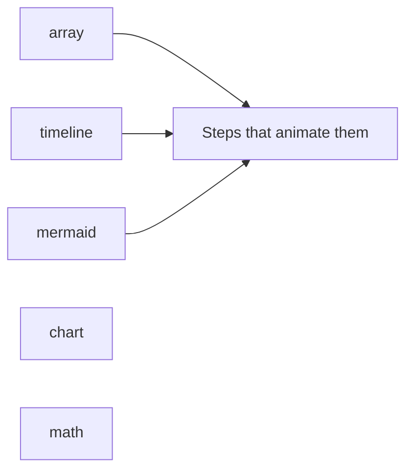

# Show arrays, charts, timelines, diagrams and maths

These blocks cover what code review videos explain besides code: how an
algorithm moves through data, what changed in the numbers, what happens when,
how requests flow, and the cost of an approach.



## Arrays

```text
array #a 1 3 4 6 8 11 15 19 ptr="lo=0 hi=7"
ptr #a hi=5
swap #a 0 3
mark #a cells=1,5
```

Values are the words after the id. `ptr=` names pointers and their starting
cells, counting from 0. `ptr #a hi=5` slides a pointer, `swap #a 0 3` slides
two cells past each other, and `mark #a cells=…` brightens some cells and
dims the rest. Indexes are shown under the cells.

## Charts

```text
chart #c bar
  burst, before, after
  1, 4, 1
  2, 7, 1
```

The first line names the columns: the row label, then one series per column.
`chart bar` groups bars per row and `chart line` draws one line per series.
The last series is drawn bright and earlier ones grey. Bars grow and lines
trace as the chart enters. The axis rounds up to a tidy number.

## Timelines

```text
timeline #tl unit=ms
  request A | 4-66 wait | *68-82 200
  db load   | *8-62 one load for both
play #tl for=2.5s
```

Each line is a lane: a label, then spans as `from-to label`. A `*` marks a
span as important, drawn bright; others are dashed. `play` sweeps a playhead
across the axis.

## Diagrams

```text
mermaid #flow
  flowchart LR
    C[Client] --> G[Gateway]
    G --> H{Cache hit?}
    H -- yes --> R[Respond]
    H -- no --> D[(Database)]
walk #flow C G H D
```

A Mermaid flowchart (`LR` or `TD`) becomes ordinary reel elements: `[ ]`
boxes, `{ }` decisions, `(( ))` circles, `[( )]` stores and `( )` rounded
boxes. Links can be `-->`, `---`, `-.->`, `==>`, `-- text -->` or
`-->|text|`. Nodes are placed in ranks by their longest path from a start
node. A link that skips ranks goes over the boxes between its ends.

Because nodes are parts, `#flow/H` targets one node with any step, and
`walk #flow C G H D` lights each node and the link into it in order.
Subgraphs are not supported yet.

Sequence diagrams are drawn too:

```text
mermaid #seq
  sequenceDiagram
    participant C as Client
    C->>A: GET /items
    alt cache miss
      A->>D: SELECT items
      D-->>A: rows
    else cache hit
      Note over A: served from memory
    end
    A-->>C: 200 OK
play #seq for=3s
```

Participants get boxes and dashed lifelines. `->>` is a call, `-->>` a dashed
reply, `-x` a lost message, and a message to yourself loops back. `Note over`,
`left of` and `right of` add notes; `alt`, `else`, `opt`, `loop`, `par` and
`critical` draw labelled frames. `autonumber` numbers the messages. `play`
reveals the rows one after another; without it everything shows once the
diagram has entered.

## Maths

```text
math "T(n) = 2T(n/2) + O(n) \Rightarrow O(n \log n)"
```

Formulas are typeset by a TeX engine built into the binary and drawn as
outlines, so they take theme colours and fade like text. Backslashes on a
`math` line are left for TeX. Plain TeX is supported, plus `\mathrm`, `\text`,
`\mathbf`, `\mathit`, `\log`, `\ln`, `\max` and `\min`.

## Known gaps

- The maths engine adds about 7 MB to the binary.

## Git histories

`git` blocks are described in [Play a scene](play-a-scene.md#git-histories).
